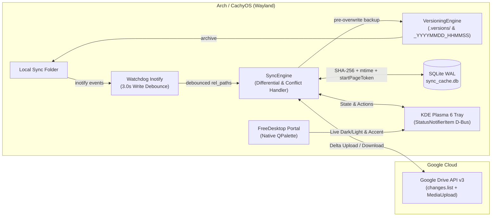

# BearSync (`gdrive-sync`)

**Production-grade, lightweight, native Linux bi-directional Google Drive sync client built for Wayland and KDE Plasma 6 on Arch Linux / CachyOS.**

[](https://github.com/morganlowe/BearSync/actions/workflows/lint.yml)
[](https://www.gnu.org/licenses/gpl-3.0)
[](https://cachyos.org/)
[](https://kde.org/plasma-desktop/)

---

## Architecture Overview



### Key Engineering Highlights
1. **Pure Wayland & KDE Plasma 6 Integration**:
   - Runs natively under Wayland (`QT_QPA_PLATFORM=wayland;xcb`) with an explicit Wayland `app_id` (`org.bearsync.gdrive-sync`) matching `StartupWMClass` in `gdrive-sync.desktop` for crisp taskbar icons, KWin window rules, and notifications.
   - Uses `QSystemTrayIcon` backed by KDE Plasma's `StatusNotifierItem` (SNI) D-Bus specification with scalable 22x22 SVG icons (`assets/`).
   - **Zero Hardcoded CSS**: Dynamically honors KDE Plasma 6 light/dark color schemes and accent colors via `QPalette`, `QStyleHints.colorSchemeChanged`, and `org.freedesktop.portal.Settings` D-Bus signals.
   - **Close-to-Tray UX**: Closing the Preferences or Setup Wizard windows overrides `closeEvent` to minimize cleanly to the system tray.
2. **Bi-Directional Differential Sync Engine**:
   - **Local-to-Remote**: Monitors filesystem events via Linux `inotify` (`watchdog`) with a configurable **3-second write debounce** to prevent partial uploads while files are actively being written.
   - **Remote-to-Local**: Polls Google Drive `changes.list` using a persisted `startPageToken` in `sync_cache.db` (SQLite WAL mode)—avoiding expensive full recursive tree scans on routine checks.
   - **Conflict Resolution**: If both local and remote copies of a file change simultaneously between sync passes, BearSync preserves the local file as `filename.conflict.YYYYMMDD_HHMMSS.ext`, uploads the conflict file, and downloads the latest remote revision.
3. **Custom Timestamp Versioning**:
   - Configurable per relative directory path (e.g., `Documents/Vault` or `*` for the entire sync root).
   - Automatically archives the pre-overwrite file before any local or remote update overwrites it—either inside `<sync_root>/.versions/<rel_dir>/filename_YYYYMMDD_HHMMSS.ext` or inline alongside the file, with automatic retention pruning.

---

## Installation on Arch Linux / CachyOS

### 1. Install Native System Dependencies (`pacman` / `paru`)

Install the system packages via `pacman` (or `paru`) so Qt6 integrates directly with KDE Plasma's Wayland platform theme (`plasma-integration` / `qqc2-breeze-style`):

```bash
sudo pacman -S --needed \
    python \
    python-pip \
    python-pyqt6 \
    qt6-wayland \
    qt6-svg \
    python-watchdog \
    python-google-api-python-client \
    python-google-auth \
    python-google-auth-oauthlib \
    python-google-auth-httplib2 \
    xdg-desktop-portal-kde
```

*(Alternatively, using `paru`: `paru -S --needed python-pyqt6 qt6-wayland qt6-svg python-watchdog python-google-api-python-client python-google-auth-oauthlib`)*

### 2. Install BearSync (`gdrive-sync`)

Clone the repository and install in editable or user mode:

```bash
git clone https://github.com/morganlowe/BearSync.git
cd gdrive-sync
pip install --no-build-isolation --user -e .
```

*(Or in a virtual environment bearing system site-packages so native Qt6 Wayland plugins are inherited:)*

```bash
python -m venv --system-site-packages .venv
source .venv/bin/activate
pip install -e .
```

### 3. Install Desktop Launcher, Icons & Systemd User Service

```bash
# Install Wayland-compliant .desktop entry
install -Dm644 gdrive-sync.desktop ~/.local/share/applications/org.bearsync.gdrive-sync.desktop

# Install scalable app icon & tray assets
install -Dm644 assets/gdrive-sync.svg ~/.local/share/icons/hicolor/scalable/apps/gdrive-sync.svg
mkdir -p ~/.local/share/gdrive-sync/assets
cp -r assets/*.svg ~/.local/share/gdrive-sync/assets/

# Install and enable the systemd user service for automatic background startup
install -Dm644 systemd/gdrive-sync.service ~/.config/systemd/user/gdrive-sync.service
systemctl --user daemon-reload
systemctl --user enable --now gdrive-sync.service
```

---

## Google Cloud OAuth2 Setup Guide

BearSync uses your own personal Google Cloud OAuth2 desktop credentials to communicate directly with Google Drive without any third-party intermediaries.

For detailed step-by-step instructions with pictures and troubleshooting, see [docs/OAUTH_SETUP.md](docs/OAUTH_SETUP.md).

### Quick Summary:
1. Open the [Google Cloud Console](https://console.cloud.google.com/).
2. Create a new project (e.g., `BearSync`) and enable the **Google Drive API** in APIs & Services &rarr; Library.
3. In **APIs & Services → OAuth consent screen**:
   - Choose **External**, name the app `BearSync`, and under **Test users** add your Google email address.
4. In **APIs & Services → Credentials**:
   - Click **+ Create Credentials → OAuth client ID**.
   - Application type: **Desktop app**.
   - Name: `BearSync Desktop`.
5. Enter your **Client ID** and **Client Secret** into BearSync's Setup Wizard (or click **Load client_secret.json...**), then click **Sign in with Google**.
   - Your session token is saved securely with `0600` permissions in `~/.config/gdrive-sync/token.json`.

---

## CLI Usage

```text
usage: gdrive-sync [-h] [--version] [--minimized] [--sync-now] [--open-folder]
                   [--preferences] [--setup] [--debug]

options:
  -h, --help     show this help message and exit
  --version      show program's version number and exit
  --minimized    Start quietly in the KDE Plasma system tray without opening modals
  --sync-now     Trigger an immediate full bi-directional sync pass
  --open-folder  Open the local Google Drive sync directory in the file manager
  --preferences  Open the BearSync Preferences window
  --setup        Launch the OAuth2 & Folder Setup Wizard
  --debug        Enable verbose debug logging
```

If an instance of `gdrive-sync` is already running in the system tray, invoking `gdrive-sync --sync-now`, `--open-folder`, or `--preferences` communicates with the active daemon over a local IPC socket (`org.bearsync.gdrive-sync.ipc`).

---

## Building Distribution Packages (Arch Linux / CachyOS & Debian / Ubuntu)

### Arch Linux / CachyOS (`.pkg.tar.zst`)

Build a native Arch Linux package using `makepkg` via the included build script or root `PKGBUILD`:

```bash
./packaging/arch/build-arch.sh
sudo pacman -U dist/gdrive-sync-1.0.0-1-any.pkg.tar.zst
```

### Debian / Ubuntu (`.deb`)

Build a native `.deb` package on any Linux host (via `dpkg-deb`) or using `dpkg-buildpackage`:

```bash
./packaging/debian/build-deb.sh
sudo apt install ./dist/gdrive-sync_1.0.0-1_all.deb
```

---

## Repository Structure

```text
├── .github/workflows/lint.yml     # Flake8, Black, and Pytest CI workflow
├── .gitignore                     # Python, venv, SQLite DBs, OAuth secrets, .cache
├── LICENSE                        # GNU GPL v3.0
├── README.md                      # Architecture, setup guide, paru/pacman deps
├── pyproject.toml                 # PEP 621 build config & dependencies
├── gdrive-sync.desktop            # Wayland-compliant desktop launcher
├── systemd/
│   └── gdrive-sync.service        # User systemd service for background autostart
├── assets/                        # Scalable 22x22 SVG SNI tray status icons
│   ├── error.svg
│   ├── gdrive-sync.svg
│   ├── idle.svg
│   ├── paused.svg
│   └── syncing.svg
├── src/
│   ├── __init__.py
│   ├── main.py                    # App entrypoint, CLI flags, IPC, Wayland setup
│   ├── app_id.py                  # Wayland desktop detection & FreeDesktop Portal watcher
│   ├── tray.py                    # StatusNotifierItem tray menu & icon runner
│   ├── watcher.py                 # Debounced Linux inotify watcher (3.0s debounce)
│   ├── sync_engine.py             # Bi-directional differential sync & conflict resolution
│   ├── versioning.py              # Custom timestamp file-rotation engine
│   ├── drive_api.py               # Drive API v3 wrapper (OAuth2, upload, changes.list)
│   ├── db.py                      # SQLite WAL schema, queries, SHA-256 indexing
│   └── ui/
│       ├── __init__.py
│       ├── preferences_dialog.py  # Native QPalette-themed settings window
│       └── setup_wizard.py        # First-run OAuth2 & folder configuration wizard
└── tests/
    └── test_sync_and_versioning.py
```
